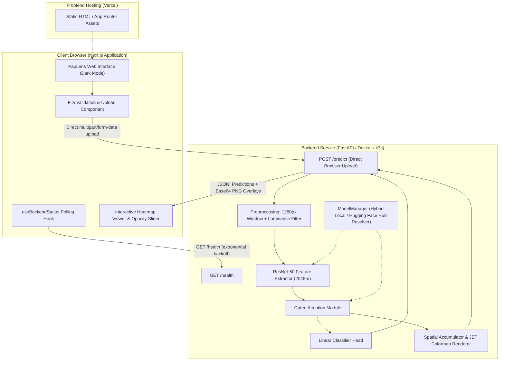

# PapLens

Interpretable cervical cytology classification with attention-based multiple instance learning. Research demo.

> [!IMPORTANT]
> **Dataset Attribution:**  
> Demo of a model trained on the PapSmear-BD dataset (2,253 conventional Pap-smear FOV images). This app does not distribute the dataset.

> [!CAUTION]
> **Clinical Disclaimer:**  
> Research demo only. Not for clinical or diagnostic use. This software is an academic research prototype and is not a medical device. It has not been evaluated, cleared, or approved by any medical regulatory authority (such as the FDA, CE, or DGDA). It must not be used for clinical screening, diagnosis, triage, or patient management decisions.

---

## Table of Contents

- [Overview](#overview)
- [Methodology and Model Pipeline](#methodology-and-model-pipeline)
- [System Architecture](#system-architecture)
- [Repository Structure](#repository-structure)
- [Empirical Benchmarks](#empirical-benchmarks)
- [Local Development](#local-development)
  - [Prerequisites](#prerequisites)
  - [Backend Setup](#backend-setup)
  - [Frontend Setup](#frontend-setup)
  - [Test Suites and Parity Verification](#test-suites-and-parity-verification)
- [Container Execution](#container-execution)
- [API Specification](#api-specification)
- [Production Deployment](#production-deployment)
  - [Deployment Order and CORS](#deployment-order-and-cors)
  - [Hugging Face Spaces](#hugging-face-spaces)
  - [Vercel](#vercel)
  - [Kubernetes and k3s Self-Hosting](#kubernetes-and-k3s-self-hosting)
- [Known Limitations](#known-limitations)
- [License](#license)

---

## Overview

PapLens is a decoupled full-stack machine learning application designed to deploy an Attention-Based Multiple Instance Learning (AB-MIL) model for cervical cytology screening. The system processes conventional Pap-smear Field-of-View (FOV) microscopy images (typically 4000 x 3000 pixels) and provides both slide-level classification and patch-level spatial attention heatmaps.

The primary goal of the application is explainability: alongside a categorical prediction, the interface visualizes the exact cellular clusters that guided the attention network's output, allowing researchers to evaluate model focus against cytopathological criteria.

---

## Methodology and Model Pipeline

The underlying machine learning pipeline follows a weakly supervised Multiple Instance Learning formulation:

1. **Sliding-Window Patch Extraction:**  
   High-resolution FOV images (approximately 12 Megapixels) are traversed using a 1280 x 1280 pixel sliding window with a stride of 640 pixels (50% overlap).
2. **Background Filtering:**  
   Patches with greater than 85% background area (defined by luminance values exceeding 220 in grayscale space) are discarded. This eliminates empty glass areas and concentrates inference exclusively on cellular material.
3. **Deep Feature Embedding:**  
   Retained patches are resized to 224 x 224 pixels, normalized using standard ImageNet channel statistics, and passed through a ResNet-50 feature extractor truncated prior to the final fully connected classification layer, yielding a 2048-dimensional embedding vector per patch.
4. **Gated Attention Mechanism:**  
   The sequence of patch embeddings is aggregated using a Gated Attention module:
   $$a_k = \frac{\exp\{w^T (\tanh(V h_k^T) \odot \text{sigm}(U h_k^T))\}}{\sum_{j=1}^K \exp\{w^T (\tanh(V h_j^T) \odot \text{sigm}(U h_j^T))\}}$$
   Where $V$ and $U$ are learned linear projections, $\odot$ represents element-wise multiplication, and $w$ represents the attention head weights.
5. **Bag Representation and Classification Head:**  
   The slide-level representation vector $z = \sum_{k=1}^K a_k h_k$ is passed to a linear classification head producing unnormalized class logits.
6. **Heatmap Generation and Spatial Accumulation:**  
   Patch attention weights $a_k$ are mapped back to their original coordinates on the full-resolution slide. Overlapping stride regions are normalized using a spatial count mask, smoothed, and projected onto a downscaled display image (maximum 1024 pixels on the longest side) using an OpenCV JET colormap.

### Supported Tasks

The system exposes two distinct evaluation tasks via an interface selector:
- **2-Class Clinical Triage (Flagship):** Normal (Negative for Intraepithelial Lesion or Malignancy - NILM) vs. Abnormal (Epithelial Cell Abnormalities).
- **3-Class Severity Grading:** Normal vs. Low-Grade Lesion (LSIL) vs. High-Grade Lesion / Carcinoma (HSIL / SCC).

---

## System Architecture



### Architectural Decisions

- **Direct Browser Uploads:** Image payloads are sent directly from the client browser to the backend API (`NEXT_PUBLIC_API_URL`). Uploads are not proxied through Next.js serverless routes, avoiding Vercel's 4.5 MB request body limit for serverless functions.
- **Downscaled Base64 Overlays:** While inference runs on full-resolution 1280 x 1280 pixel image crops, the resulting attention overlay and reference image are downscaled to a maximum dimension of 1024 pixels for network transport (~350 KB base64 payload instead of 20 MB uncompressed image data).
- **Hybrid Weight Resolution:** The backend first attempts to load PyTorch weights from the local filesystem (`backend/weights/`). If weights are absent (e.g. in minimal container builds), it falls back to downloading them from a designated Hugging Face Hub repository (`HF_REPO_ID`).

---

## Repository Structure

```
paplens/
├── backend/
│   ├── app/
│   │   ├── __init__.py
│   │   ├── config.py             # Configuration and environment variables via Pydantic Settings
│   │   ├── heatmap.py            # Spatial accumulation, count-mask normalization, colormap rendering
│   │   ├── labels.py             # Class mappings, Bethesda taxonomy, display strings
│   │   ├── main.py               # FastAPI application, lifespan handler, CORS middleware, routes
│   │   ├── model.py              # ResNet-50 and Gated Attention-MIL architecture definitions
│   │   ├── preprocess.py         # Image decoding, sliding-window patch extractor, background filter
│   │   └── schemas.py            # Pydantic V2 schemas for prediction and error responses
│   ├── weights/                  # Directory for model weight files (gitignored)
│   │   ├── 04_2Class_Triage/
│   │   └── 05_3Class_Severity/
│   ├── scripts/
│   │   └── parity_check.py       # Verification script comparing wrapper output with thesis models
│   ├── tests/                    # Pytest test suite (11 unit and integration tests)
│   │   ├── conftest.py
│   │   ├── test_health.py
│   │   ├── test_predict.py
│   │   └── test_validation.py
│   ├── Dockerfile                # Production Dockerfile (python:3.12-slim, non-root user, CPU torch)
│   ├── requirements.txt          # Pinned Python package dependencies
│   └── README.md                 # Hugging Face Spaces deployment documentation
├── frontend/
│   ├── src/
│   │   ├── app/
│   │   │   ├── globals.css       # Tailwind CSS v4 styles and dark mode color variables
│   │   │   ├── layout.tsx        # Root HTML layout and metadata configuration
│   │   │   └── page.tsx          # Single-page dashboard layout
│   │   ├── components/
│   │   │   ├── Disclaimer.tsx    # Research and regulatory disclaimer component
│   │   │   ├── ErrorBanner.tsx   # Dismissible error display
│   │   │   ├── HeatmapViewer.tsx # Side-by-side view, opacity blend slider, top patch bounding boxes
│   │   │   ├── HowItWorks.tsx    # Model architecture summary and dataset attribution text
│   │   │   ├── ImageUploader.tsx # Drag-and-drop input, file validation, model type selector
│   │   │   ├── ResultCard.tsx    # Diagnostic classification, confidence metrics, probability breakdown
│   │   │   ├── SampleImages.tsx  # Pre-configured test sample selector
│   │   │   └── ServerStatus.tsx  # Health pill indicator (checking, waking, online, offline)
│   │   ├── hooks/
│   │   │   └── useBackendStatus.ts # Server health polling hook with exponential backoff
│   │   ├── lib/
│   │   │   ├── api.ts            # Typed API client with AbortController timeout handling
│   │   │   ├── types.ts          # TypeScript interfaces mirroring backend Pydantic schemas
│   │   │   └── validation.ts     # Client-side file type and file size validation
│   │   └── tests/
│   │       ├── api.test.ts       # Vitest tests for API error and timeout scenarios
│   │       ├── ResultCard.test.tsx # React Testing Library component tests
│   │       └── setup.ts          # Vitest environment setup and jest-dom extensions
│   ├── public/
│   │   └── samples/              # Directory for static sample images (.gitkeep)
│   ├── package.json              # Next.js 16, React 19, Tailwind CSS v4, Vitest
│   ├── tsconfig.json             # TypeScript compiler settings
│   ├── vitest.config.ts          # Vitest testing configuration
│   └── README.md                 # Frontend deployment documentation
├── .gitignore                    # Excludes virtual environments, cache, build artifacts, weights
└── README.md                     # Root project documentation
```

---

## Empirical Benchmarks

The following benchmarks were measured on a full-resolution 4000 x 3000 pixel FOV image using CPU-only inference on standard x86_64 hardware:

| Benchmark | Measured Value | Notes |
| :--- | :--- | :--- |
| Cold-start inference latency | 6.48 seconds | Measured on first request after model load (CPU) |
| Warm inference latency | 5.98 seconds | Steady-state request processing (CPU) |
| Average foreground patches | 24 patches | Derived from 1280 x 1280 window with 50% overlap |
| Feature extraction runtime | ~4.92 seconds | ResNet-50 forward pass across 24 patches on CPU |
| Attention pooling and head runtime | < 15 milliseconds | Gated Attention and classification layer |
| Heatmap accumulation runtime | ~0.38 seconds | Coordinate projection, count normalization, JET colormap |
| Docker image size | 669 MB | Multi-stage build on `python:3.12-slim` |
| Floating-point parity difference ($\Delta$) | 0.00e+00 | Exact numerical identity with original thesis code |
| 2-Class Triage Accuracy | `[TODO: add thesis metrics]` | Independent PapSmear-BD test split |
| 3-Class Severity Accuracy | `[TODO: add thesis metrics]` | Independent PapSmear-BD test split |

---

## Local Development

### Prerequisites

- Python 3.11 or 3.12
- Node.js 20.x or 22.x LTS
- npm 10+
- Docker (optional, for containerized local execution)

---

### Backend Setup

1. Navigate to the backend directory:
   ```bash
   cd backend
   ```

2. Create and activate a Python virtual environment:
   ```bash
   python3 -m venv .venv
   source .venv/bin/activate
   ```

3. Install required packages:
   ```bash
   pip install --upgrade pip
   pip install -r requirements.txt
   ```

4. Verify model weights exist in `backend/weights/`:
   - `backend/weights/04_2Class_Triage/04_MIL_ResNet50_Final_2Class_Triage_StateDict.pt`
   - `backend/weights/05_3Class_Severity/05_MIL_ResNet50_Final_3Class_Severity_StateDict.pt`

5. Start the FastAPI development server:
   ```bash
   uvicorn app.main:app --host 0.0.0.0 --port 7860 --reload
   ```

The API will be available at `http://localhost:7860`. Interactive OpenAPI documentation is accessible at `http://localhost:7860/docs`.

---

### Frontend Setup

1. In a separate terminal, navigate to the frontend directory:
   ```bash
   cd frontend
   ```

2. Install dependencies:
   ```bash
   npm install
   ```

3. Set up the local environment configuration:
   ```bash
   cp .env.example .env.local
   ```
   Ensure `.env.local` contains:
   ```env
   NEXT_PUBLIC_API_URL=http://localhost:7860
   ```

4. Start the Next.js development server:
   ```bash
   npm run dev
   ```

The web application will be accessible at `http://localhost:3000`.

---

### Test Suites and Parity Verification

#### Backend Unit Tests (Pytest)
The backend test suite verifies endpoint availability, schema conformity, file validation, corrupt image rejection, determinism, and CORS headers:
```bash
cd backend
source .venv/bin/activate
pytest -v
```

Expected result: 11 passing tests.

#### Numerical Parity Gate
The parity script processes real slide images through both the original research inference logic and the production wrapper, asserting equivalence of probabilities and attention weights within a tolerance of $10^{-6}$:
```bash
cd backend
source .venv/bin/activate
python scripts/parity_check.py
```

#### Frontend Unit Tests (Vitest)
The frontend test suite verifies client API error handling, network timeouts, and component rendering:
```bash
cd frontend
npm test
```

Expected result: 7 passing tests.

#### Production Build Verification
To ensure TypeScript types, Tailwind stylesheets, and page pre-renders compile cleanly:
```bash
cd frontend
npm run build
```

---

## Container Execution

The backend can be built and run in an isolated Docker container with zero host dependencies beyond Docker itself.

### Build Docker Image
```bash
cd backend
docker build -t paplens-backend .
```

### Run Container
```bash
docker run -p 7860:7860 --name paplens-api paplens-backend
```

### Verify Container Health
```bash
curl -s http://localhost:7860/health | jq .
```

---

## API Specification

### `GET /health`
Returns the operational status of the service and confirms that model weights are loaded in memory.

**Response (200 OK):**
```json
{
  "status": "healthy",
  "model_loaded": true,
  "available_models": ["triage", "severity"],
  "uptime_seconds": 124.5
}
```

---

### `POST /predict`
Performs slide-level inference and returns classification probabilities alongside attention heatmap overlays.

**Parameters:**
- `model_type` *(query parameter, string, optional)*: Target classification model. Options: `triage` (default) or `severity`.

**Request Body:**
- `file` *(form-data, binary, required)*: The Pap-smear FOV image file (JPEG or PNG, maximum 10 MB).

**Example cURL Request:**
```bash
curl -X POST "http://localhost:7860/predict?model_type=triage" \
  -H "Accept: application/json" \
  -F "file=@/path/to/cervical_fov_slide.jpg"
```

**Response (200 OK):**
```json
{
  "model_type": "triage",
  "predicted_class": "Abnormal",
  "display_name": "Abnormal (Epithelial Abnormalities)",
  "severity_level": "danger",
  "confidence": 0.9852,
  "probabilities": {
    "Normal": 0.0148,
    "Abnormal": 0.9852
  },
  "classes": ["Normal", "Abnormal"],
  "num_patches": 24,
  "inference_time_ms": 5980.4,
  "overlay_base64": "data:image/png;base64,iVBORw0KGgo...",
  "heatmap_only_base64": "data:image/png;base64,iVBORw0KGgo...",
  "original_display_base64": "data:image/png;base64,iVBORw0KGgo...",
  "display_width": 1024,
  "display_height": 768,
  "top_patches": [
    {
      "rank": 1,
      "attention_weight": 0.1428,
      "normalized_attention": 1.0,
      "box_original": [1280, 640, 2560, 1920],
      "box_display": [327, 163, 655, 491]
    }
  ]
}
```

---

## Production Deployment

### Deployment Order and CORS

To avoid cross-origin resource sharing (CORS) failures or mixed-content browser blocking:

1. **Deploy the Backend First:**  
   Deploy the backend service to Hugging Face Spaces or a Kubernetes cluster. Note the assigned public HTTPS URL (e.g. `https://username-paplens.hf.space`).
2. **Deploy the Frontend to Vercel:**  
   Provide the backend URL as the environment variable `NEXT_PUBLIC_API_URL`. Note your assigned Vercel production domain (e.g. `https://paplens.vercel.app`).
3. **Configure Backend CORS Origins:**  
   Update the backend's `ALLOWED_ORIGINS` environment variable to include the Vercel domain:
   ```
   ALLOWED_ORIGINS=https://paplens.vercel.app,http://localhost:3000
   ```
4. **HTTPS Requirement:**  
   Modern web browsers block unencrypted HTTP requests initiated from an HTTPS origin (Mixed Content policy). Both frontend and backend must be served over HTTPS.

---

### Hugging Face Spaces

1. Create a new Space at `https://huggingface.co/new-space`.
   - Name: `paplens`
   - SDK: **Docker**
   - Hardware: **CPU Basic (Free)**
2. Push the backend directory:
   ```bash
   cd backend
   git init
   git remote add space https://huggingface.co/spaces/<your-username>/paplens
   git add .
   git commit -m "Deploy PapLens inference service"
   git push space main
   ```
3. In the Space **Settings > Variables and secrets**, add:
   - Key: `ALLOWED_ORIGINS`
   - Value: `https://<your-vercel-domain>.vercel.app,http://localhost:3000`

---

### Vercel

1. In the Vercel dashboard, import the repository and specify the **Root Directory** as `frontend`.
2. In the project settings, configure the environment variable:
   - `NEXT_PUBLIC_API_URL` = `https://<your-username>-paplens.hf.space`
3. Deploy. The Next.js application will compile static assets and execute without serverless proxy overhead.

---

### Kubernetes and k3s Self-Hosting

For self-hosting on a local or production k3s cluster, use the following manifest:

```yaml
apiVersion: apps/v1
kind: Deployment
metadata:
  name: paplens-backend
  namespace: default
  labels:
    app: paplens-backend
spec:
  replicas: 1
  selector:
    matchLabels:
      app: paplens-backend
  template:
    metadata:
      labels:
        app: paplens-backend
    spec:
      containers:
      - name: backend
        image: <your-registry>/paplens-backend:latest
        imagePullPolicy: IfNotPresent
        ports:
        - containerPort: 7860
        env:
        - name: ALLOWED_ORIGINS
          value: "https://paplens.yourdomain.com,http://localhost:3000"
        - name: PORT
          value: "7860"
        - name: TORCH_NUM_THREADS
          value: "4"
        resources:
          requests:
            cpu: "1000m"
            memory: "1Gi"
          limits:
            cpu: "2000m"
            memory: "2Gi"
        readinessProbe:
          httpGet:
            path: /health
            port: 7860
          initialDelaySeconds: 10
          periodSeconds: 10
        livenessProbe:
          httpGet:
            path: /health
            port: 7860
          initialDelaySeconds: 15
          periodSeconds: 20
---
apiVersion: v1
kind: Service
metadata:
  name: paplens-backend-service
  namespace: default
spec:
  type: ClusterIP
  selector:
    app: paplens-backend
  ports:
  - port: 7860
    targetPort: 7860
```

Apply the deployment:
```bash
kubectl apply -f paplens-backend.yaml
```

---

## Known Limitations

1. **Optical Magnification and Slide Medium:**  
   The model was trained exclusively on conventional Pap-smear slides captured as high-power Field-of-View microscopy images (~40x objective). It is not validated for low-power macroscopic overviews, liquid-based cytology preparations (e.g. ThinPrep or SurePath), or consumer smartphone camera photographs.
2. **Stain and Illumination Variability:**  
   Differences in Papanicolaou staining protocols, counter-stain intensity, or microscope light-source calibration across clinical laboratories can affect luminance-based background thresholding and attention distributions.
3. **Debris and Artifacts:**  
   Dense mucus accumulation, overlapping inflammatory cells, and slide preparation artifacts may occasionally attract non-zero attention weights if morphological features resemble dysplastic nuclei.
4. **Processing Throughput on CPU:**  
   Extracting 24 foreground patches and executing a 24-pass ResNet-50 feature extraction requires approximately 6 seconds on CPU. While optimized for zero-cost hosting tiers, high-throughput clinical evaluation pipelines would require GPU acceleration.

---

## License

This project is released under the MIT License. Model weights and dataset references remain the intellectual property of their original authors.
