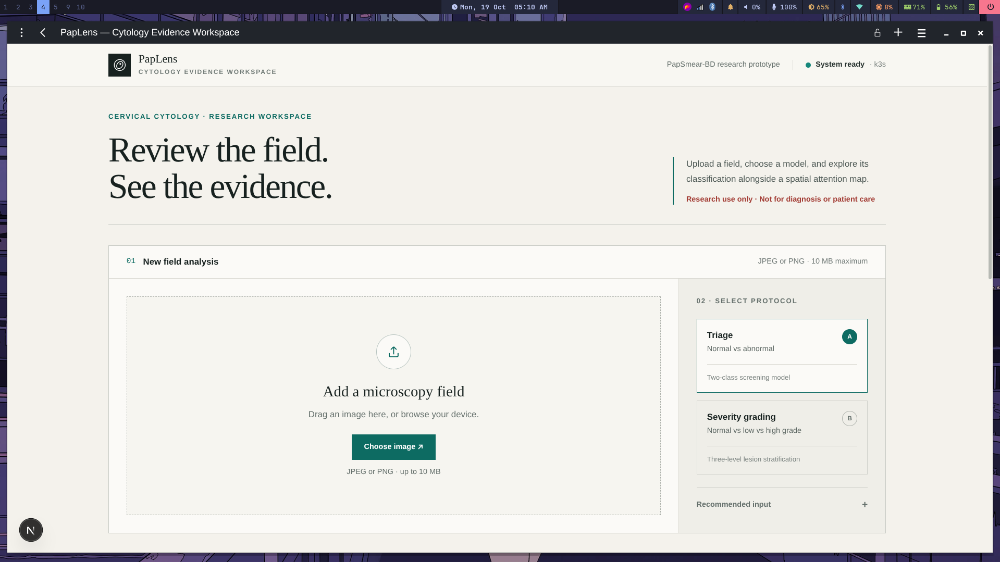
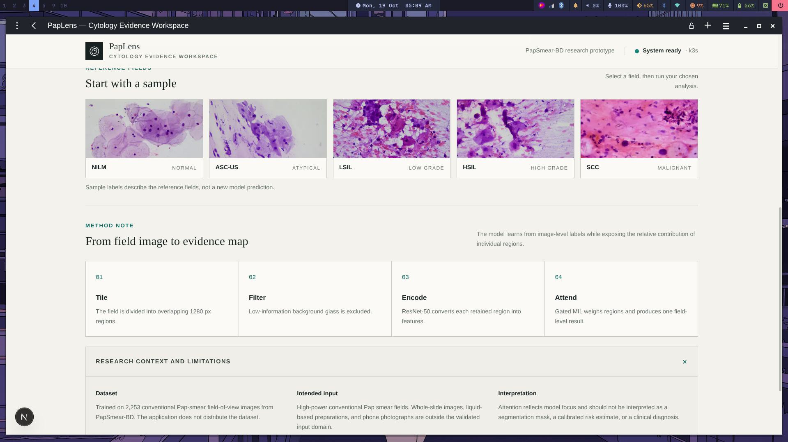
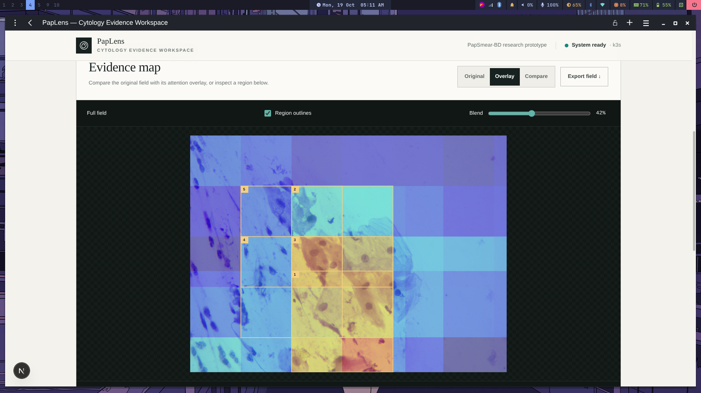
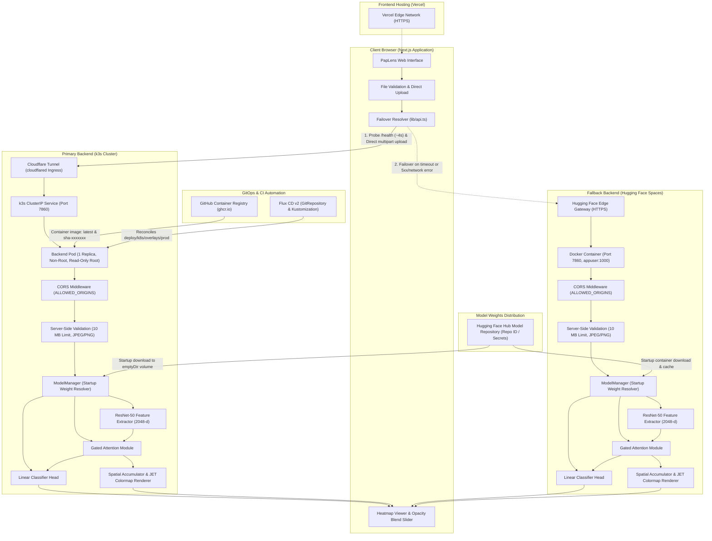

# PapLens

Interpretable cervical cytology classification with attention-based multiple instance learning. Research demo.

> [!IMPORTANT]
> **Dataset Attribution:**  
> Demo of a model trained on the PapSmear-BD dataset (2,253 conventional Pap-smear FOV images). This app does not distribute the dataset.

> [!CAUTION]
> **Clinical Disclaimer:**  
> Research demo only. Not for clinical or diagnostic use. This software is an academic research prototype and is not a medical device. It has not been evaluated, cleared, or approved by any medical regulatory authority (such as the FDA, CE, or DGDA). It must not be used for clinical screening, diagnosis, triage, or patient management decisions.

---

## Table of Contents

- [Overview](#overview)
- [Methodology and Model Pipeline](#methodology-and-model-pipeline)
- [Tech Stack](#tech-stack)
- [System Architecture](#system-architecture)
- [Subsystem Documentation](#subsystem-documentation)
- [Repository Structure](#repository-structure)
- [Empirical Benchmarks](#empirical-benchmarks)
- [Local Development](#local-development)
  - [Prerequisites](#prerequisites)
  - [Backend Setup](#backend-setup)
  - [Frontend Setup](#frontend-setup)
  - [Test Suites and Parity Verification](#test-suites-and-parity-verification)
- [Container Execution](#container-execution)
- [API Specification](#api-specification)
- [Production Dual Deployment](#production-dual-deployment)
  - [Deployment Sequence](#deployment-sequence)
- [Known Limitations](#known-limitations)
- [License](#license)

---

## Overview

PapLens is a decoupled full-stack machine learning application designed to deploy an Attention-Based Multiple Instance Learning (AB-MIL) model for cervical cytology screening. The system processes conventional Pap-smear Field-of-View (FOV) microscopy images (typically 4000 x 3000 pixels) and provides both slide-level classification and patch-level spatial attention heatmaps.

The primary goal of the application is explainability: alongside a categorical prediction, the interface visualizes the exact cellular clusters that guided the attention network's output, allowing researchers to evaluate model focus against cytopathological criteria.

<!-- Interface Screenshots -->

*Figure 1: Workspace landing view. Upload a microscopy field (drag-and-drop or browse), select Triage (2-class) or Severity grading (3-class), and run inference. The header badge shows live backend status — k3s cluster or Hugging Face Spaces fallback.*


*Figure 2: Reference fields panel showing all five Bethesda-class sample images (NILM, ASC-US, LSIL, HSIL, SCC) for one-click staging. Below, the method note documents the four inference stages: Tile, Filter, Encode, and Attend.*


*Figure 3: Evidence map viewer (Overlay mode). Warmer colors indicate higher model attention. Numbered bounding boxes mark the top-5 highest-attention patches. The blend slider controls heatmap opacity. Original / Overlay / Compare view modes and one-click PNG export are available.*

---

## Methodology and Model Pipeline

The underlying machine learning pipeline follows a weakly supervised Multiple Instance Learning formulation:

1. **Sliding-Window Patch Extraction:**  
   High-resolution FOV images (approximately 12 Megapixels) are traversed using a 1280 x 1280 pixel sliding window with a stride of 640 pixels (50% overlap).
2. **Background Filtering:**  
   Patches with greater than 85% background area (defined by luminance values exceeding 220 in grayscale space) are discarded. This eliminates empty glass areas and concentrates inference exclusively on cellular material.
3. **Deep Feature Embedding:**  
   Retained patches are resized to 224 x 224 pixels, normalized using standard ImageNet channel statistics, and passed through a ResNet-50 feature extractor truncated prior to the final fully connected classification layer, yielding a 2048-dimensional embedding vector per patch.
4. **Gated Attention Mechanism:**  
   The sequence of patch embeddings is aggregated using a Gated Attention module:
   $$a_k = \frac{\exp\{w^T (\tanh(V h_k^T) \odot \text{sigm}(U h_k^T))\}}{\sum_{j=1}^K \exp\{w^T (\tanh(V h_j^T) \odot \text{sigm}(U h_j^T))\}}$$
   Where $V$ and $U$ are learned linear projections, $\odot$ represents element-wise multiplication, and $w$ represents the attention head weights.
5. **Bag Representation and Classification Head:**  
   The slide-level representation vector $z = \sum_{k=1}^K a_k h_k$ is passed to a linear classification head producing unnormalized class logits.
6. **Heatmap Generation and Spatial Accumulation:**  
   Patch attention weights $a_k$ are mapped back to their original coordinates on the full-resolution slide. Overlapping stride regions are normalized using a spatial count mask, smoothed, and projected onto a downscaled display image (maximum 1024 pixels on the longest side) using an OpenCV JET colormap.

### Supported Tasks

The system exposes two distinct evaluation tasks via an interface selector:
- **2-Class Clinical Triage (Flagship):** Normal (Negative for Intraepithelial Lesion or Malignancy - NILM) vs. Abnormal (Epithelial Cell Abnormalities).
- **3-Class Severity Grading:** Normal vs. Low-Grade Lesion (LSIL) vs. High-Grade Lesion / Carcinoma (HSIL / SCC).

## Tech Stack

### Deep Learning and Numerical Inference
- **PyTorch (v2.14+ CPU):** Feedforward execution, tensor manipulation, and gradient-free inference optimized for multi-core CPUs.
- **Torchvision (v0.29+ CPU):** ResNet-50 feature extractor truncated prior to the final classification layer, yielding 2048-dimensional embeddings per patch.
- **Attention-Based Deep MIL:** Gated Attention network (Ilse et al.) implementing learned instance aggregation and interpretable spatial weighting.
- **OpenCV Headless (v5.0+):** Sliding-window patch extraction, spatial count-mask accumulation, and JET colormap rendering for attention heatmaps.
- **Pillow & NumPy (v2.x):** Image decoding, spatial validation, luminance-based background thresholding, and numerical array operations.

### Backend Service and API
- **FastAPI (v0.143+):** Asynchronous Python web framework serving OpenAPI-compliant prediction and health check endpoints.
- **Uvicorn (v0.54+):** Standard ASGI production web server.
- **Pydantic V2 & Pydantic-Settings:** Request validation, response serialization, and environment configuration management.
- **Hugging Face Hub Python SDK (`huggingface_hub`):** Hybrid model weight resolution, downloading PyTorch checkpoints into local volumes on startup.
- **Pytest & HTTPX:** Test suite verifying API contracts, payload boundaries, corrupt file rejection, and CORS enforcement.

### Frontend Client and UI
- **Next.js 16 (App Router):** Modern React 19 framework using Turbopack compilation and edge-optimized static page generation.
- **TypeScript:** Strict type safety mirroring backend Pydantic schemas without loose `any` types.
- **Tailwind CSS v4:** Utility-first CSS styling and layout primitives.
- **Client Failover Resolver (`lib/api.ts`):** Direct browser-to-backend communication bypassing serverless payload limits, featuring proactive health probes and single-retry failover.
- **Vitest & React Testing Library:** Unit testing for client failover resolution, error states, and UI components.

### Infrastructure, GitOps, and Edge
- **Primary Backend Hosting:** Lightweight Kubernetes (`k3s`) cluster running single-replica non-root containers with read-only root filesystems.
- **GitOps Reconciliation:** Flux CD v2 automatically synchronizing cluster state from Git (`deploy/flux/` and `deploy/k8s/overlays/prod/`).
- **Edge Ingress:** Cloudflare Tunnel (`cloudflared`) routing external HTTPS traffic securely to the cluster with zero open inbound ports.
- **Failsafe Backend Hosting:** Hugging Face Spaces (Docker CPU SDK, port 7860) running the identical container image and inference logic.
- **Frontend Hosting:** Vercel edge deployment with global CDN delivery.
- **CI/CD & Registry:** GitHub Actions (`.github/workflows/backend-image.yml`) building and publishing images to GitHub Container Registry (GHCR).

---

## System Architecture



### Architectural Decisions

- **Direct Browser Uploads:** Image payloads are sent directly from the client browser to the active backend API (`NEXT_PUBLIC_API_URL_PRIMARY` or `NEXT_PUBLIC_API_URL_FALLBACK`). Uploads are never proxied through Next.js serverless routes, completely avoiding Vercel's 4.5 MB serverless request body limits.
- **Client-Side Automated Failover:** `lib/api.ts` probes `/health` on the primary k3s cluster with a short 4-second timeout. If the cluster is unreachable or times out, it switches to the Hugging Face Space fallback with waking backoff. If an in-flight `/predict` request fails with a network error or 5xx response, it retries once on the alternate backend.
- **Single Backend Container Image:** Both the primary k3s deployment and the Hugging Face Space run the exact same `backend/Dockerfile` image on port 7860 as non-root UID 1000.
- **Hybrid Weight Resolution:** The backend first attempts to load PyTorch weights from the local filesystem (`backend/weights/`). If weights are absent, it downloads them from a private or public Hugging Face Hub repository (`HF_REPO_ID`) into an ephemeral volume. Weights are never committed to plain Git or baked into the Docker image.
- **Downscaled Base64 Overlays:** While inference evaluates full-resolution 1280 x 1280 pixel crops, the spatial attention overlay and reference image are downscaled to a maximum dimension of 1024 pixels for network transport (~350 KB base64 payload instead of 20 MB uncompressed image data).

---

## Subsystem Documentation

The PapLens repository is partitioned into decoupled subsystems, each accompanied by dedicated documentation:

- **Backend API Documentation:** [`backend/README.md`](backend/README.md)  
  Covers the FastAPI service, PyTorch model loader, CPU optimizations, hybrid weight resolver (`huggingface_hub`), environment variables, local Docker execution, and instructions for deploying the Hugging Face Spaces failsafe backend.
- **Frontend Web Client Documentation:** [`frontend/README.md`](frontend/README.md)  
  Covers the Next.js 16 App Router interface, Tailwind CSS v4 styling, client failover resolver implementation (`lib/api.ts`), dual-endpoint configuration, and Vercel edge deployment.
- **Production Deployment & GitOps Guide:** [`deploy/README.md`](deploy/README.md)  
  Comprehensive operational guide detailing the 7-step deployment sequence across the primary k3s cluster (via Flux CD v2 GitOps and Cloudflare Tunnel ingress) and the Hugging Face Space failsafe, plus failover verification steps.

---

## Repository Structure

```
paplens/
├── backend/                      # FastAPI inference service -> see backend/README.md
│   ├── app/
│   │   ├── __init__.py
│   │   ├── config.py             # Configuration and environment variables via Pydantic Settings
│   │   ├── heatmap.py            # Spatial accumulation, count-mask normalization, colormap rendering
│   │   ├── labels.py             # Class mappings, Bethesda taxonomy, display strings
│   │   ├── main.py               # FastAPI application, lifespan handler, CORS middleware, routes
│   │   ├── model.py              # ResNet-50 and Gated Attention-MIL architecture definitions
│   │   ├── preprocess.py         # Image decoding, sliding-window patch extractor, background filter
│   │   └── schemas.py            # Pydantic V2 schemas for prediction and error responses
│   ├── weights/                  # Directory for model weight files (gitignored)
│   │   ├── 2Class_Triage/
│   │   └── 3Class_Severity/
│   ├── scripts/
│   │   └── parity_check.py       # Verification script comparing wrapper output with thesis models
│   ├── tests/                    # Pytest test suite (11 unit and integration tests)
│   │   ├── conftest.py
│   │   ├── test_health.py
│   │   ├── test_predict.py
│   │   └── test_validation.py
│   ├── Dockerfile                # Production Dockerfile (python:3.12-slim, non-root user, CPU torch)
│   ├── requirements.txt          # Pinned Python package dependencies
│   └── README.md                 # Backend documentation -> backend/README.md
├── frontend/                     # Next.js web application -> see frontend/README.md
│   ├── src/
│   │   ├── app/
│   │   │   ├── globals.css       # Tailwind CSS v4 styles and theme variables
│   │   │   ├── layout.tsx        # Root HTML layout and metadata configuration
│   │   │   └── page.tsx          # Single-page dashboard layout
│   │   ├── components/           # UI components (Viewer, Uploader, Results, Status, Disclaimer)
│   │   ├── hooks/
│   │   │   └── useBackendStatus.ts # Server health polling hook with exponential backoff
│   │   ├── lib/
│   │   │   ├── api.ts            # Client failover resolver and typed API client
│   │   │   ├── types.ts          # TypeScript interfaces mirroring backend Pydantic schemas
│   │   │   └── validation.ts     # Client-side file type and file size validation
│   │   └── tests/                # Vitest test suite (12 unit and integration tests)
│   ├── public/
│   │   └── samples/              # Directory for static sample images (.gitkeep)
│   ├── package.json              # Next.js 16, React 19, Tailwind CSS v4, Vitest
│   ├── tsconfig.json             # TypeScript compiler settings
│   ├── vitest.config.ts          # Vitest testing configuration
│   └── README.md                 # Frontend documentation -> frontend/README.md
├── deploy/                       # Kubernetes, GitOps, and Ingress manifests -> see deploy/README.md
│   ├── k8s/
│   │   ├── base/                 # Base k8s Deployment, Service, ConfigMap, Secrets, Cloudflare Tunnel
│   │   └── overlays/prod/        # Production overlay with pinned image SHA tag
│   ├── flux/                     # Flux CD v2 GitRepository and Kustomization manifests
│   └── README.md                 # Deployment & failover verification guide -> deploy/README.md
├── .github/
│   └── workflows/
│       └── backend-image.yml     # Automated GHCR container build and push workflow
├── .gitignore                    # Excludes virtual environments, cache, build artifacts, weights
└── README.md                     # Root project documentation
```

---

## Empirical Benchmarks

The following benchmarks were measured on a full-resolution 4000 x 3000 pixel FOV image using CPU-only inference on standard x86_64 hardware:

| Benchmark | Measured Value | Notes |
| :--- | :--- | :--- |
| Cold-start inference latency | 6.48 seconds | Measured on first request after model load (CPU) |
| Warm inference latency | 5.98 seconds | Steady-state request processing (CPU) |
| Average foreground patches | 24 patches | Derived from 1280 x 1280 window with 50% overlap |
| Feature extraction runtime | ~4.92 seconds | ResNet-50 forward pass across 24 patches on CPU |
| Attention pooling and head runtime | < 15 milliseconds | Gated Attention and classification layer |
| Heatmap accumulation runtime | ~0.38 seconds | Coordinate projection, count normalization, JET colormap |
| Docker image size | 669 MB | Multi-stage build on `python:3.12-slim` |
| Floating-point parity difference ($\Delta$) | 0.00e+00 | Exact numerical identity with original thesis code |
| 2-Class Triage Accuracy | `[TODO: add thesis metrics]` | Independent PapSmear-BD test split |
| 3-Class Severity Accuracy | `[TODO: add thesis metrics]` | Independent PapSmear-BD test split |

---

## Local Development

### Prerequisites

- Python 3.11 or 3.12
- Node.js 20.x or 22.x LTS
- npm 10+
- Docker (optional, for containerized local execution)

---

### Backend Setup

1. Navigate to the backend directory:
   ```bash
   cd backend
   ```

2. Create and activate a Python virtual environment:
   ```bash
   python3 -m venv .venv
   source .venv/bin/activate
   ```

3. Install required packages:
   ```bash
   pip install --upgrade pip
   pip install -r requirements.txt
   ```

4. Verify model weights exist in `backend/weights/`:
   - `backend/weights/2Class_Triage/best_cnn_extractor.pth` & `best_abmil_focal.pth`
   - `backend/weights/3Class_Severity/best_cnn_extractor.pth` & `best_abmil_focal.pth`

5. Start the FastAPI development server:
   ```bash
   uvicorn app.main:app --host 0.0.0.0 --port 7860 --reload
   ```

The API will be available at `http://localhost:7860`. Interactive OpenAPI documentation is accessible at `http://localhost:7860/docs`.

For detailed endpoint specifications, configuration tables, and standalone Docker execution, see the [Backend Documentation](backend/README.md).

---

### Frontend Setup

1. In a separate terminal, navigate to the frontend directory:
   ```bash
   cd frontend
   ```

2. Install dependencies:
   ```bash
   npm install
   ```

3. Set up the local environment configuration:
   ```bash
   cp .env.example .env.local
   ```
   Ensure `.env.local` contains:
   ```env
   NEXT_PUBLIC_API_URL_PRIMARY=http://localhost:7860
   NEXT_PUBLIC_API_URL_FALLBACK=https://sabidmahmud-paplens.hf.space
   ```

4. Start the Next.js development server:
   ```bash
   npm run dev
   ```

The web application will be accessible at `http://localhost:3000`.

For component structure, state management, and Vercel hosting guidelines, see the [Frontend Documentation](frontend/README.md).

---

### Test Suites and Parity Verification

#### Backend Unit Tests (Pytest)
The backend test suite verifies endpoint availability, schema conformity, file validation, corrupt image rejection, determinism, and CORS headers:
```bash
cd backend
source .venv/bin/activate
pytest -v
```

Expected result: 11 passing tests.

#### Numerical Parity Gate
The parity script verifies numerical equivalence between the research model evaluation and production wrapper logic:
```bash
cd backend
source .venv/bin/activate
python scripts/parity_check.py
```

#### Frontend Unit Tests (Vitest)
The frontend test suite verifies client failover resolver scenarios (primary healthy, fallback healthy, both down, retry on 5xx/network error), file validation, and UI component rendering:
```bash
cd frontend
npm test
```

Expected result: 12 passing tests.

#### Production Build Verification
To ensure TypeScript types, Tailwind stylesheets, and page pre-renders compile cleanly:
```bash
cd frontend
npm run build
```

---

## Container Execution

The backend can be built and run in an isolated Docker container with zero host dependencies beyond Docker itself.

### Build Docker Image
```bash
cd backend
docker build -t paplens-backend .
```

### Run Container
```bash
docker run -p 7860:7860 --name paplens-api paplens-backend
```

### Verify Container Health
```bash
curl -s http://localhost:7860/health | jq .
```

---

## API Specification

### `GET /health`
Returns the operational status of the service and confirms that model weights are loaded in memory.

**Response (200 OK):**
```json
{
  "status": "ok",
  "models_loaded": true,
  "available_models": ["triage", "severity"],
  "device": "cpu",
  "torch_threads": 4,
  "version": "1.0.0"
}
```

---

### `POST /predict`
Performs slide-level inference and returns classification probabilities alongside attention heatmap overlays.

**Parameters:**
- `model_type` *(query parameter, string, optional)*: Target classification model. Options: `triage` (default) or `severity`.

**Request Body:**
- `file` *(form-data, binary, required)*: The Pap-smear FOV image file (JPEG or PNG, maximum 10 MB).

**Example cURL Request:**
```bash
curl -X POST "http://localhost:7860/predict?model_type=triage" \
  -H "Accept: application/json" \
  -F "file=@/path/to/cervical_fov_slide.jpg"
```

**Response (200 OK):**
```json
{
  "model_type": "triage",
  "predicted_class": "Abnormal",
  "display_name": "Abnormal (Epithelial Abnormalities)",
  "severity_level": "danger",
  "confidence": 0.9852,
  "probabilities": {
    "Normal": 0.0148,
    "Abnormal": 0.9852
  },
  "classes": ["Normal", "Abnormal"],
  "num_patches": 24,
  "inference_time_ms": 5980.4,
  "overlay_base64": "data:image/png;base64,iVBORw0KGgo...",
  "heatmap_only_base64": "data:image/png;base64,iVBORw0KGgo...",
  "original_display_base64": "data:image/png;base64,iVBORw0KGgo...",
  "display_width": 1024,
  "display_height": 768,
  "top_patches": [
    {
      "rank": 1,
      "attention_score": 0.1428,
      "raw_attention": 0.0892,
      "box": {
        "x": 1280,
        "y": 640,
        "width": 1280,
        "height": 1280
      },
      "box_display": {
        "x": 327,
        "y": 163,
        "width": 327,
        "height": 327
      }
    }
  ]
}
```

---

## Production Dual Deployment

PapLens uses a dual-deployment topology designed for zero-downtime availability and automated client failover:

- **Primary Backend:** Self-hosted on a `k3s` Kubernetes cluster managed declaratively via **Flux CD v2** GitOps and securely exposed over a **Cloudflare Tunnel** (`cloudflared`) with zero open inbound ports.
- **Failsafe Backend:** Hosted on **Hugging Face Spaces** (Docker CPU SDK, port 7860) running the identical container image and inference pipeline.
- **Frontend:** Hosted on **Vercel** (Next.js 16 App Router) with client-side failover resolution implemented in `lib/api.ts`.
- **Model Weights Distribution:** PyTorch checkpoint weights are stored in a Hugging Face Hub model repository and downloaded at container startup into an ephemeral volume (`emptyDir` on k3s, local cache on Spaces). Weights are never committed to Git or baked into the Docker image.

For full Kubernetes manifests, Kustomize configurations, Cloudflare Tunnel setup, and Flux CD manifests, see [`deploy/README.md`](deploy/README.md).

### Deployment Sequence

Deploy services in the following order to ensure seamless SSL termination and eliminate CORS rejections:

1. **Build and Publish Container Image:**  
   GitHub Actions workflow (`.github/workflows/backend-image.yml`) builds and publishes `ghcr.io/<username>/paplens-backend` tagged with `latest` and `sha-<git-commit-hash>`.
2. **Deploy to k3s via Flux CD:**  
   Flux reconciles `./deploy/k8s/overlays/prod` against the cluster, deploying the backend Pod, ClusterIP Service, and Cloudflare Tunnel sidecar/deployment.
3. **Verify External HTTPS Health:**  
   Confirm public accessibility over the Cloudflare Tunnel hostname:
   ```bash
   curl -i https://api-paplens.yourdomain.com/health
   ```
4. **Deploy Hugging Face Space Failsafe:**  
   Push `backend/` to your Hugging Face Space. Set `HF_REPO_ID` and `HF_TOKEN` in Space secrets.
5. **Configure CORS on Both Backends:**  
   Set `ALLOWED_ORIGINS` on both the k3s ConfigMap and Hugging Face Space settings to your Vercel production domain:
   ```env
   ALLOWED_ORIGINS=https://paplens.vercel.app,http://localhost:3000
   ```
6. **Deploy Frontend to Vercel:**  
   Import `frontend` into Vercel and define:
   ```env
   NEXT_PUBLIC_API_URL_PRIMARY=https://api-paplens.yourdomain.com
   NEXT_PUBLIC_API_URL_FALLBACK=https://<username>-paplens.hf.space
   ```
7. **Test Automated Failover:**  
   Scale the k3s Deployment to 0 replicas:
   ```bash
   kubectl scale deployment/paplens-backend --replicas=0 -n paplens
   ```
   Refresh the web interface: the status badge switches to `Served by: Hugging Face Spaces (fallback)` and inferences continue uninterrupted. Scale the deployment back to 1 replica to restore primary routing.

---

## Known Limitations

1. **Optical Magnification and Slide Medium:**  
   The model was trained exclusively on conventional Pap-smear slides captured as high-power Field-of-View microscopy images (~40x objective). It is not validated for low-power macroscopic overviews, liquid-based cytology preparations (e.g. ThinPrep or SurePath), or consumer smartphone camera photographs.
2. **Stain and Illumination Variability:**  
   Differences in Papanicolaou staining protocols, counter-stain intensity, or microscope light-source calibration across clinical laboratories can affect luminance-based background thresholding and attention distributions.
3. **Debris and Artifacts:**  
   Dense mucus accumulation, overlapping inflammatory cells, and slide preparation artifacts may occasionally attract non-zero attention weights if morphological features resemble dysplastic nuclei.
4. **Processing Throughput on CPU:**  
   Extracting 24 foreground patches and executing a 24-pass ResNet-50 feature extraction requires approximately 6 seconds on CPU. While optimized for zero-cost hosting tiers, high-throughput clinical evaluation pipelines would require GPU acceleration.

---

## License

This project is released under the MIT License. Model weights and dataset references remain the intellectual property of their original authors.
